# 絵コンテ

各カットの静止画（動画の中間フレーム）とナレーション。秒数は声なしのプレビュー版（声を入れると声の長さに合わせて変わります）。

| # | 秒 | 画面 | 内容 |
|---|---|---|---|
| 1 | 0.0–3.0 | 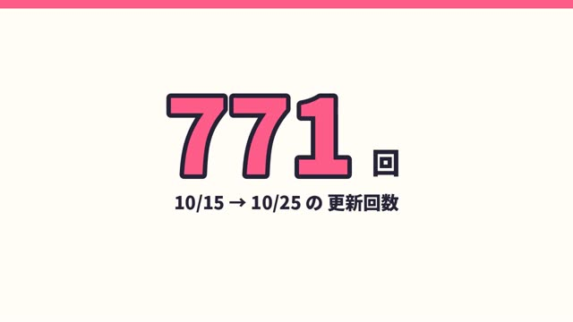 | **(タイトルなし)** 11日間で、772回アップデートしたのだ！ |
| 2 | 3.0–7.4 | 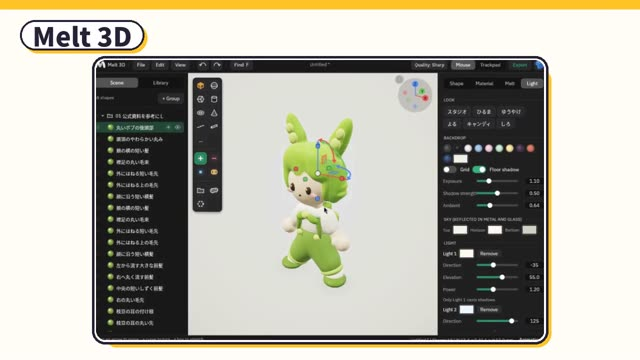 | **Melt 3D** 高校生とAIで作った、3Dモデリングアプリ、メルト3Dなのだ！ |
| 3 | 7.4–11.0 | 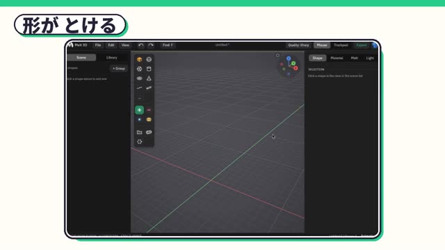 | **形が とける** 形を並べると、とろーっと、なめらかにくっつくのだ！ |
| 4 | 11.0–14.4 | 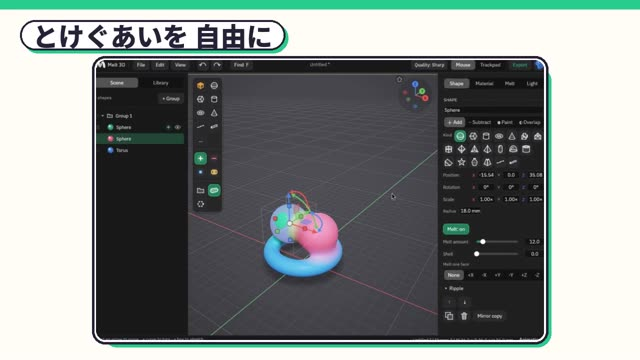 | **とけぐあいを 自由に** スライダーひとつで、とけぐあいも自由自在なのだ！ |
| 5 | 14.4–18.4 | 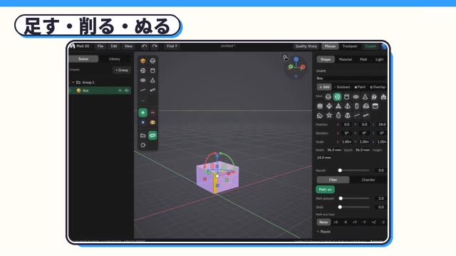 | **足す・削る・ぬる** 足す、削る、ぬる。形を組み合わせて、なんでも作れるのだ！ |
| 6 | 18.4–21.6 | 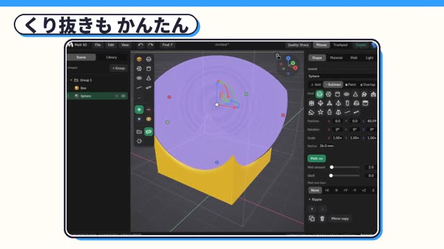 | **くり抜きも かんたん** ボールで削って、穴もあけて、色もぬれるのだ！ |
| 7 | 21.6–24.2 | 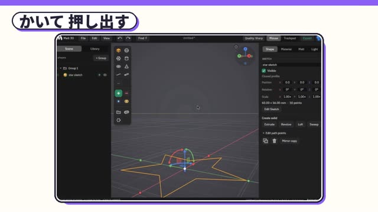 | **かいて 押し出す** 絵をかいて、ぐーっと押し出すのだ！ |
| 8 | 24.2–27.2 | 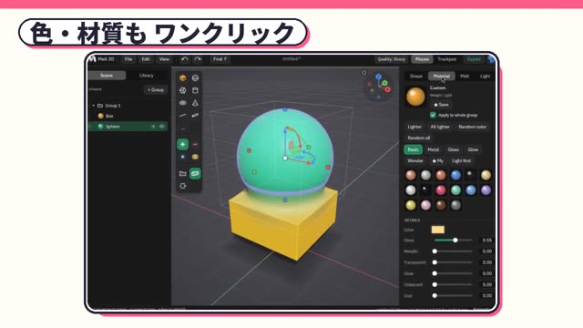 | **色・材質も ワンクリック** 色や材質も、ワンクリックで変えられるのだ！ |
| 9 | 27.2–30.7 | 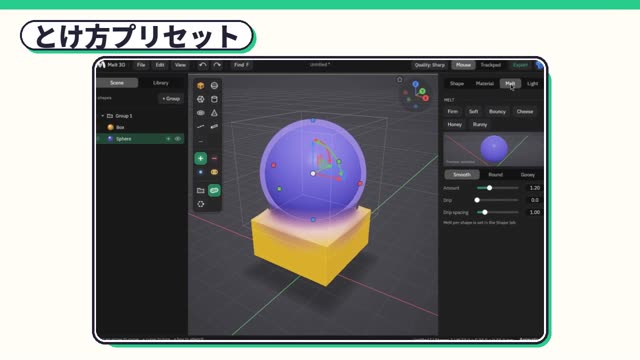 | **とけ方プリセット** チーズやハチミツみたいな、とけ方の見本もあるのだ！ |
| 10 | 30.7–33.3 | 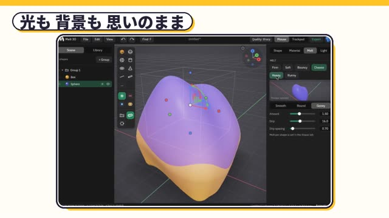 | **光も 背景も 思いのまま** 光も背景も、夕焼けにできるのだ！ |
| 11 | 33.3–37.3 | 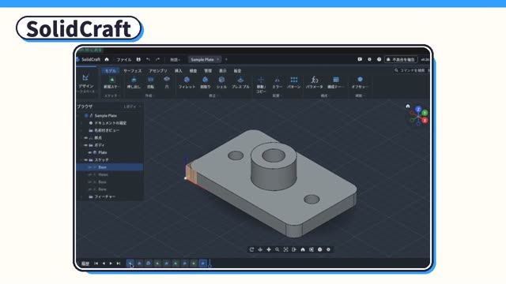 | **SolidCraft** 寸法が大事なときは、本格CADのソリッドクラフトなのだ！ |
| 12 | 37.3–40.6 | 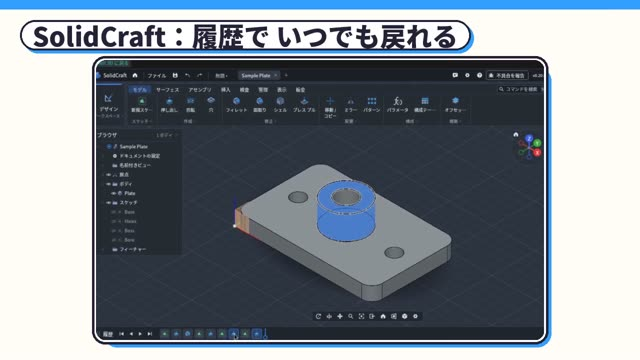 | **SolidCraft：履歴で いつでも戻れる** 作った手順は履歴に残って、いつでも直せるのだ！ |
| 13 | 40.6–46.3 | 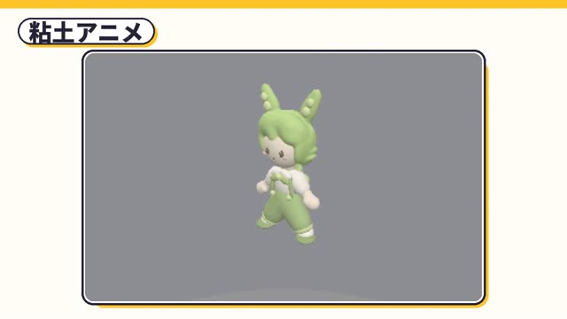 | **粘土アニメ** ポーズを置くだけで、粘土アニメみたいに動くのだ！ボクも、メルト3Dで作ったのだ！ |
| 14 | 46.3–50.9 | 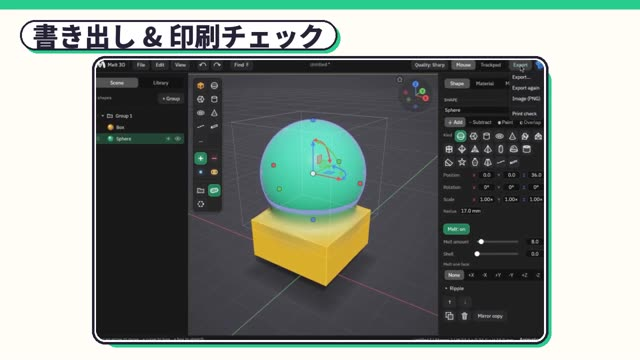 | **書き出し & 印刷チェック** STLや3MFで書き出せて、印刷できるか、チェックもできるのだ！ |
| 15 | 50.9–56.1 | 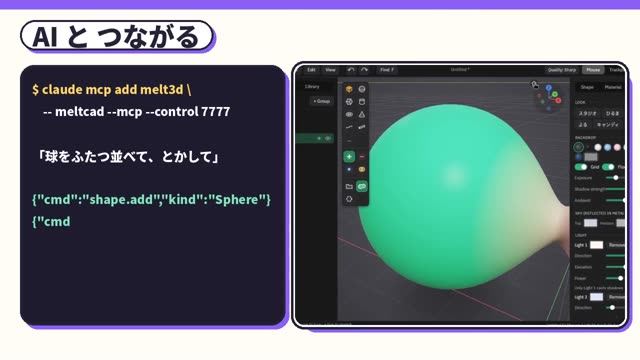 | **AI と つながる** AIにも、つながるのだ！ことばで頼むと、メルト3Dを動かしてくれるのだ！ |
| 16 | 56.1–58.8 | 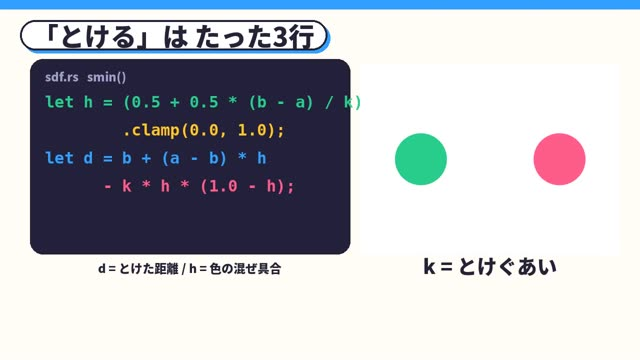 | **「とける」は たった3行** とけるの正体は、たった3行の式なのだ！ |
| 17 | 58.8–64.5 | 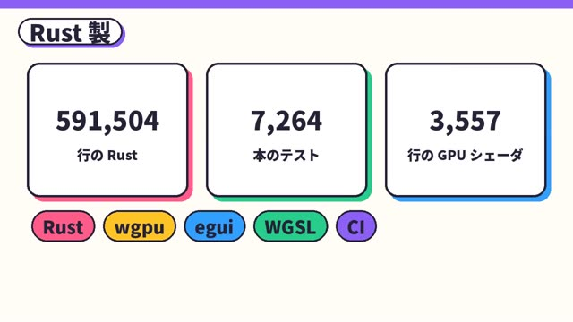 | **Rust 製** 中身はラスト製！59万行、テスト7000本以上、GPUで描くから軽くて速いのだ！ |
| 18 | 64.5–70.6 | 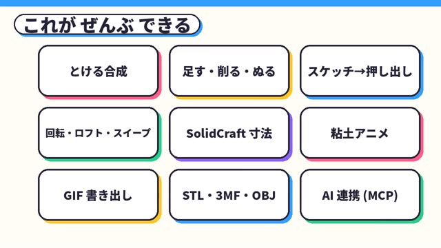 | **これが ぜんぶ できる** とかす、足す削る、スケッチ、ソリッド、アニメ、書き出し、AI連携！ぜんぶ入ってるのだ！ |
| 19 | 70.6–75.6 | 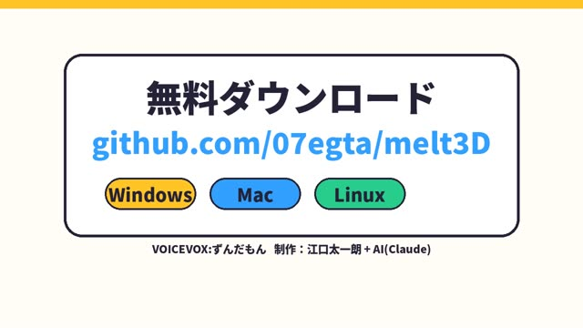 | **(タイトルなし)** メルト3Dは、無料でオープンソース！みんなも、形を、とかしてみるのだ！ |
